# LightGravity Pitch Deck Outline & Copy (Google Cloud AI Builder Cup 2026)

This document defines the master narrative arc and slide-by-slide copy for the **LightGravity (TeamBot)** pitch deck. Visual styling, color tokens, and typography strictly follow [design.md](design.md).

---

## 0. Core Thesis & Narrative Arc

* **Competition & Track**: Google Cloud AI Builder Cup 2026 (Hack2skill) · *Future of Work & Enterprise Productivity*
* **The Five Pillars of the Pitch**:
  1. **The Paradigm Shift**: AI agents have moved beyond writing code into daily team work (research, documents, multimodal materials, operations). However, **Git workflows don't fit non-code daily work**, while **chat streams are unstructured logs** where context scatters and nobody can be held accountable for the output.
  2. **The Two Foundations**: We replace chaotic chat threads and opaque databases with **File as Single Source of Truth (File SoT: Markdown + YAML + JSONL)** and an explicit **Task Ontology**—bringing "Git-grade" traceability and state validation to everyday deliverables.
  3. **One Team Bot, Dual-Layer Collaboration**:
     * **Human Team Layer**: Individual accounts, `Personal` vs. `Team` workspaces, silent group chat with explicit `@bot` invocation, and cross-account review & acceptance.
     * **AI Team Layer**: **275 recruitable specialist roles** dynamically assembled per task, mandatory **Independent Reviewer** separation (`Reviewer ≠ Author`), and three code-enforced governance gates.
  4. **Google Dual-Engine Foundation & Cloud Run**: Powered at the core by **Google Antigravity SDK** (agent loop, skills, tool calls, native sessions) and **Google EmbeddingGemma 2** (unified multimodal semantic retrieval as a rebuildable cache over File SoT), deployed as a single stateless container on **Google Cloud Run**.
  5. **Scale & Vision (Toward Olav-OS)**: Evolving from our verified MVP baseline toward:
     * **Olav-OS Human + Agent First-Class Citizens**: Bridging the human-orchestration gap by scheduling human employees and AI workers as equal nodes in the same dependency graph, alongside a **governed self-organizing swarm**;
     * **Object Storage + lakeFS Data Lake**: Bringing zero-copy branching, atomic commits, merges, and rollbacks to all multimodal files on Google Cloud Storage;
     * **Lightweight Office Support**: Native intake, diffing, and preview for `.docx`, `.xlsx`, and `.pptx`;
     * **Fine-Grained RBAC & Scoped ACLs**: Task- and source-level permissions, budget quotas, and scoped acceptance authority.

```mermaid
flowchart LR
    subgraph M1["I. Paradigm Shift (01-02)"]
        S1["01. Cover<br/>Human-AI Team Workspace"] --> S2["02. The Problem<br/>Chat ≠ Record / No Accountability"]
    end
    subgraph M2["II. Two Foundations (03-04)"]
        S2 --> S3["03. File SoT + Ontology<br/>Git-Grade Record for Daily Work"]
        S3 --> S4["04. End-to-End Flow<br/>Sources → Task → Run → Review → Accept"]
    end
    subgraph M3["III. Dual-Layer Teams (05-06)"]
        S4 --> S5["05. Human Team<br/>Personal/Team · @bot · Cross-Account Accept"]
        S5 --> S6["06. AI Task Teams<br/>275 Roles · Independent Reviewer · 3 Gates"]
    end
    subgraph M4["IV. Google Tech & Proof (07-09)"]
        S6 --> S7["07. Google Dual Engines<br/>Antigravity SDK × EmbeddingGemma 2"]
        S7 --> S8["08. Cloud Architecture<br/>Code Control + Cloud Run Container"]
        S8 --> S9["09. Production Validation<br/>1,061+ Tests · Rubric Alignment"]
    end
    subgraph M5["V. Scale & Closer (10-11)"]
        S9 --> S10["10. Vision: Toward Olav-OS<br/>Human+Agent · lakeFS · Office · RBAC"]
        S10 --> S11["11. Closer & Live Links<br/>120s Film · Live Demo · GitHub"]
    end
```

---

## Act I: The Paradigm Shift

### Slide 01 · Cover: The Human-AI Team Workspace for Daily Work
* **Canvas Ground**: `bg-paper` (`#F4EFE6`)
* **Section Tag**: `— GOOGLE CLOUD AI BUILDER CUP 2026 · FUTURE OF WORK & ENTERPRISE PRODUCTIVITY`
* **Headline**: **LIGHT** *gravity*
* **Subheadline**: **The Human-AI Team Workspace that delivers** *reviewable, accountable work.*
  Give your team bot the context and the goal. Get deliverables your team can inspect, review, and accept.
* **Visual Motif**: Celestial orbital diagram on the right (Central star = `TASK`, orbiting rings = `Human Teammates`, `Task-Scoped AI Workers`, and `Independent Reviewer`).
* **Bottom Tech Badges (Hard-Border Pills)**:
  * `[GOOGLE ANTIGRAVITY SDK]` (Safety Orange fill)
  * `[EMBEDDINGGEMMA 2]` (Acid Lime fill)
  * `[GOOGLE CLOUD RUN & VERTEX AI]`
  * `[FILE SOT · TASK ONTOLOGY]`

---

### Slide 02 · The Problem: Agents Moved Beyond Code. Chat Didn't.
* **Canvas Ground**: `bg-obsidian` (`#111116`)
* **Section Tag**: `— § 01 — THE PARADIGM SHIFT`
* **Headline**: **Agents moved beyond code.** *Chat didn't.*
* **Lead-in**: AI agents are now handling everyday team work—research, documents, multimodal sources, and operations. But team collaboration is stuck in a gap.
* **Three Core Breakdowns (`01` / `02` / `03`)**:
  * **`01` Git doesn't fit daily work**
    Software engineers have branches, diffs, and pull requests to govern code. Everyday knowledge work, documents, and cross-functional team deliverables cannot be managed through `git merge`.
  * **`02` Chat is not a work record**
    In chat threads, source materials, requirement changes, and follow-ups scatter across endless scrolling messages. Every revision rebuilds context from scratch instead of building on a single source of truth.
  * **`03` Output without accountability**
    Single-agent tools run with unbounded autonomy and no separation of duties. "Done" just means the model stopped generating—not that an independent reviewer checked the evidence or a human teammate accepted the delivery.
* **Bottom Callout**: `WHO FEELS IT` — Small teams and professionals who delegate real deliverables to AI while remaining accountable for the final result.

---

## Act II: The Two Foundations

### Slide 03 · Foundations: File SoT + Task Ontology (A "Git-Grade" Record for Daily Work)
* **Canvas Ground**: `bg-paper` (`#F4EFE6`)
* **Section Tag**: `— § 02 — THE TWO FOUNDATIONS`
* **Headline**: **File Truth & Task Ontology:** *A "Git-grade" record for daily work.*
* **Top Half: Two Foundation Cards (Side-by-Side)**
  * **Foundation A · File as Single Source of Truth (File SoT)**
    * `Markdown + YAML frontmatter` is the authoritative state for tasks, requirement revisions, and configurations; `JSONL` records conversations and runtime events.
    * You own the open files on disk. Databases and vector indexes are strictly **disposable, rebuildable caches**.
  * **Foundation B · Task Ontology (Explicit Model of Work)**
    * Defines the objects, relationships, permitted actions, and evidence required for completion: `Source ➔ Task ➔ Run / Subtask ➔ Role / Member ➔ Artifact ➔ Review ➔ Accepted`.
    * State transitions are validated deterministically by **application code**, never left to prompt guesswork.
* **Bottom Half: Capability Comparison Matrix**

| Capability | Chat Assistants | Traditional Git / Code Tools | Single-Agent Tools | **LightGravity (TeamBot)** |
| :--- | :--- | :--- | :--- | :--- |
| **Target Work Scope** | Ad-hoc Q&Athreads | Software code only | Isolated one-off runs | **✓ Daily docs, sources & engineering deliverables** |
| **Source of Truth** | ✕ Scrolling chat log | ◐ Code repo only | ✕ Vendor lock-in DB | **✓ Open File SoT (`Markdown · YAML · JSONL`)** |
| **Work State Model** | ✕ None | ◐ Commit / PR | ◐ Ephemeral session | **✓ Task Ontology (Code-validated transitions)** |
| **Team & Role Division** | ✕ Single bot | ◐ Humans only | ✕ Solo agent | **✓ Human accounts + 275 recruitable AI roles** |
| **Review & Acceptance** | ✕ Manual eyeball check | ✓ CI + Code Review | ◐ Optional / self-graded | **✓ Machine checks + Independent Reviewer + Human Accept** |

---

### Slide 04 · End-to-End Workflow: From Source Material to Accepted Delivery
* **Canvas Ground**: `bg-obsidian` (`#111116`)
* **Section Tag**: `— § 03 — END-TO-END WORKFLOW`
* **Headline**: **Every task** *orbits* **acceptance.**
* **Left Half: 6-Stage Orbital Lifecycle Diagram (Centred around `TASK: One Record`)**
  1. **Sources + Goal (`Source Intake`)**: Upload PDFs, images, docs, or audio in Chat; extract and bind versioned context to a task.
  2. **Conversation → Task**: Answer ordinary questions directly; turn delivery requests into a dedicated task directory and `TASK.md`.
  3. **Team Assembly**: Coordinator validates a deterministic plan and recruits the minimal required AI roles (`Role / Member`).
  4. **Scoped Execution**: Workers run tools inside an isolated workspace to produce deliverables (`Artifact`) and diffs.
  5. **Checks + Independent Review**: Machine checks run first, followed by a mandatory separate `Reviewer` model verdict.
  6. **Human Acceptance**: A teammate inspects the evidence on Board and clicks `Accept`—or requests changes to trigger a bounded repair loop.
* **Right Half: Real Workspace Triptych (`① Talk` · `② Deliver` · `③ Accept`)**
  * High-resolution captures of the unified left-rail workspace (`Chat`, `Board`, `Files`, `Team`, `Settings`) showing source binding, multi-role execution evidence, and the acceptance gate.

---

## Act III: Dual-Layer Team Collaboration

### Slide 05 · Layer 1 — Human Team Collaboration: Shared Context, Explicit Invocation
* **Canvas Ground**: `bg-paper` (`#F4EFE6`)
* **Section Tag**: `— § 04 — LAYER 1: HUMAN TEAM COLLABORATION`
* **Headline**: **One team bot.** *Shared across people, accountable by role.*
* **Left Visual**: Three-party intersection diagram (`Human Teammates` × `Task-Scoped AI Workers` × `Independent Reviewer` = `Accepted Work`).
* **Right Stack: Three Collaboration Pillars**
  * **1. `Personal` vs. `Team` Workspaces with Account Governance**
    * Individual user accounts with `admin` and `member` roles, session invalidation on role/password changes, and last-admin protection.
    * **Personal** provides private chat and owner-only text attachments; **Team** shares group conversations, ingested sources (`Files`), and tasks (`Board`).
  * **2. Silent Group Context + Explicit `@bot` Invocation**
    * Teammates discuss freely in Team chat—messages are saved silently as shared context without noisy bot interruptions. Only an explicit `@bot` wakes the coordinator.
  * **3. Verified Cross-Account Delivery & Acceptance Flow**
    * **Teammate A** creates the task and binds sources ➔ **AI Team** executes and passes independent review ➔ **Teammate B** signs in, inspects/tests the deliverable, and records feedback ➔ **Teammate A** reviews the record and clicks `Accept` on Board.

---

### Slide 06 · Layer 2 — AI Task Teams: 275 Specialist Roles & Three Governance Gates
* **Canvas Ground**: `bg-obsidian` (`#111116`)
* **Section Tag**: `— § 05 — LAYER 2: TASK-SCOPED AI TEAMS`
* **Headline**: **275 specialist roles.** *Governed by code, not prompts.*
* **Three Arched Pillars (`I` / `II` / `III`)**:
  * **`I` Goal-Based Recruitment & Concurrent Isolation**
    * Packages 282 pinned open-source role templates (with full provenance and MIT licensing); **275 specialist roles** are recruitable with the current toolset via deterministic goal-fit ranking.
    * Each task gets its own ephemeral team, sessions, and artifact directory. Overlapping tasks run concurrently and release execution slots automatically upon confirmed stop.
  * **`II` Mandatory Separation of Author & Judge (`Reviewer ≠ Author`)**
    * Workers returning success enter verification—they can never mark a task `done`.
    * A separately configured **Reviewer model connection** checks artifacts against `requirements_revision` and bound sources. Without an active reviewer, acceptance is blocked by code.
  * **`III` Three Hard Governance Gates**
    * **Scoped Permissions**: Role prompts and skills guide methodology but never expand Task file or tool authorization.
    * **Full-Lifecycle Budgets**: Cost ceilings span execution, verification, repair loops, and failed attempts.
    * **Confirmed Stop**: Pause, cancellation, and completion require confirmed runtime termination before state is written.

---

## Act IV: Google Dual-Engine Foundation & Production Proof

### Slide 07 · Google AI Foundation: Antigravity SDK × EmbeddingGemma 2
* **Canvas Ground**: `bg-highlight` (Cobalt Blue `#2563EB` or Warm Paper `#F4EFE6` with dual high-contrast cards)
* **Section Tag**: `— § 06 — GOOGLE AI FOUNDATION (40% TECHNICAL MERIT)`
* **Headline**: **Built on Google's** *Agent & Gemma* **ecosystem.**
* **Lead-in**: Two core Google technologies power our execution orchestration and multimodal file retrieval—going far beyond a thin prompt wrapper.
* **Dual-Engine Breakdown (Two Monolithic Hard-Border Cards)**:
  * **Engine 01 · Google Antigravity SDK (`google-antigravity==0.1.22`) — Execution Foundation**
    * **Native Agent Primitives**: Powers the agent loop, standardized skill injection (`skillRefs`), scoped file/command/web tool calls, and native session persistence across all 275 roles.
    * **Deterministic Orchestration Layer**: Unbounded internal SDK delegation is disabled by default; our Python Coordinator & Scheduler wrap the SDK with plan validation, dependency ordering, workspace isolation, and stop confirmation.
  * **Engine 02 · Google EmbeddingGemma 2 — Multimodal Context & Retrieval Foundation**
    * **Unified Multimodal Embeddings**: Maps ingested documents, OCR'd images/PDFs, and English audio transcripts into a shared semantic vector space for task context binding.
    * **Built for File SoT**: Vector indexes operate as disposable, rebuildable caches over open files. If unconfigured or offline, retrieval degrades gracefully to deterministic lexical search and original file inspection.

---

### Slide 08 · Architecture & Google Cloud Deployment
* **Canvas Ground**: `bg-obsidian` (`#111116`)
* **Section Tag**: `— § 07 — ARCHITECTURE & GOOGLE CLOUD`
* **Headline**: **Control is** *code.* **One container on** *Cloud Run.*
* **Left Half: 5-Layer Deterministic Stack (`Surface → Core`)**
  1. **Workspace UI** — `React · Vite · TypeScript` (Single left navigation: Chat, Board, Files, Team, Resources, Settings).
  2. **API & Team Auth** — `FastAPI · Pydantic · Python 3.12` (Accounts, cookie sessions, host allow-list, protected credential refs).
  3. **Coordination & Control** — Rule-based routing, deterministic plan validation, subtask scheduling, budgets, verification gates.
  4. **Agent Execution** — **Google Antigravity SDK** (Model adapters connecting Gemini / Vertex AI & OpenAI-compatible endpoints).
  5. **File SoT Persistence** — `Markdown · YAML · JSONL` + rebuildable lexical & EmbeddingGemma 2 indexes. No external DB required.
* **Right Half: Google Cloud Production Topology**
  * **Cloud Run**: Single-container deployment serving both the web UI and Python coordinator (`max-instances=1` matching the single-writer file store).
  * **Cloud Storage (GCS Volume Mount)**: Mounted at `/data` to persist `Markdown / YAML / JSONL` records and original sources directly.
  * **Secret Manager & Vertex AI**: Secures API keys by reference and powers Coordinator, Worker, Reviewer, and EmbeddingGemma 2 endpoints.

---

### Slide 09 · Production Validation & Judging Criteria Alignment
* **Canvas Ground**: `bg-paper` (`#F4EFE6`)
* **Section Tag**: `— § 08 — VALIDATION & JUDGING RUBRIC MAP`
* **Headline**: **Tested like** *production software.* **Every criterion** *answered.*
* **Top Half: Hard Engineering Evidence (4-Column Metric Grid)**
  * **`1,061`** **Backend Tests Passed** (State transitions, file locks, atomic writes, permission boundaries; 2 skipped).
  * **`181`** **Frontend Tests Passed** (Component contracts, navigation state retention, settings security).
  * **`73`** **Live Deployment Checks** (Desktop 1440px/1024px & Mobile 390px end-to-end Playwright & browser smoke tests).
  * **`2-Account`** **Verified Team Lifecycle** (Concurrent SDK tasks, dynamic role recruitment, confirmed stop/release, and cross-account acceptance).
* **Bottom Half: Hack2skill Judging Criteria Map (`40%` / `25%` / `25%` / `10%`)**
  * **`40%` Technical Merit & Gen AI**: Deep integration of **Google Antigravity SDK** + **EmbeddingGemma 2** + **Cloud Run**, 6 distinct Gen AI jobs, backed by 1,200+ automated tests.
  * **`25%` Problem & Impact**: Solves the accountability and context-loss crisis as AI agents move from coding into everyday team deliverables.
  * **`25%` Innovation**: **File SoT + Task Ontology** as a "Git-grade" protocol for daily work, 275-role dynamic assembly, and mandatory `Reviewer ≠ Author` separation.
  * **`10%` UX & Design**: Distraction-free single-rail workbench connecting chat, source provenance, execution diffs, and one-click human acceptance.

---

## Act V: Scale, Vision & Closer

### Slide 10 · Scale & Vision: From TeamBot MVP to Olav-OS
* **Canvas Ground**: `bg-obsidian` (`#111116`)
* **Section Tag**: `— § 09 — SCALE & VISION: TOWARD OLAV-OS`
* **Headline**: **Beyond the prototype:** *Humans, Agents & Data at scale.*
* **Lead-in**: Building on our verified team baseline (**Now**), our architecture is designed to scale across four strategic dimensions (**Next / Later**):
* **Four Evolution Pillars (2×2 Hard-Border Matrix)**:
  * **`01` Olav-OS Vision: Humans & Agents as First-Class Citizens + Governed Swarm**
    * **Bridging the Human-Orchestration Gap**: Today, code schedules AI workers while humans initiate and accept. Inspired by **Olav-OS**, our Task Ontology treats **Human employees and AI agents as equal first-class citizens**—enabling the scheduler to assign human action nodes (approvals, offline tasks, domain sign-offs) alongside AI subtasks in one unified dependency graph.
    * **Toward a Governed Swarm**: Within our three hard gates (permissions, lifecycle budgets, independent review), execution evolves from deterministic dispatch toward a **self-organizing multi-agent swarm**.
  * **`02` Object Storage + lakeFS Data Lake: True Git-Style File Versioning**
    * **Solving Single-Writer & Binary Scale**: To scale beyond single-instance POSIX file locks and handle massive multimodal assets, we layer **lakeFS** on top of **Google Cloud Storage (GCS)**.
    * **Zero-Copy Branching for Daily Work**: Every `Task / Run` operates on an isolated zero-copy **lakeFS branch**. Markdown records, PDFs, audio, and datasets gain atomic `branch`, `commit`, `diff`, `merge`, and `revert`—merging cleanly into `main` only upon human acceptance.
  * **`03` Lightweight Office Suite Support (`.docx` · `.xlsx` · `.pptx`)**
    * **Completing the Daily Work Loop**: Extends File SoT beyond Markdown and PDFs with a lightweight Office parsing, structured diffing, and browser preview engine—so non-technical teams can ingest, revise, and accept everyday Office deliverables with full provenance.
  * **`04` Fine-Grained Account & Permission Control (RBAC / Scoped ACLs)**
    * **Enterprise-Grade Governance**: Evolves from workspace-level `admin / member` roles to **task- and source-scoped access control**—supporting private tasks, confidential source bindings, per-role model budget quotas, and domain-specific acceptance authority.

---

### Slide 11 · Closer: Trust the Delivery, Not Just the Output
* **Canvas Ground**: `bg-highlight` (Safety Orange `#FF4D00`)
* **Section Tag**: `— THANK YOU · GOOGLE CLOUD AI BUILDER CUP 2026`
* **Headline**: **Trust the** *delivery,* **not just the output.**
* **Closing Statement**: Governed by **File SoT & Task Ontology**. Powered by **Google Antigravity SDK & EmbeddingGemma 2**. Built for human and AI teams to deliver accountable work.
* **Three Verification Cards (Bottom Row)**:
  * **`LIVE WORKSPACE`** — Deployed Cloud Run / LAN instance (`[Insert Live URL]`)
  * **`CODE & RELEASE ARCHIVE`** — Public GitHub repository & prebuilt installer (`https://github.com/yhvh-chen/lightgravity-bot`)
  * **`120s VERIFIED DEMO FILM`** — 1080p end-to-end walkthrough of two-account collaboration, role assembly & acceptance (`probes/video-20261017/v2/demo-120s.mp4`)

---

## Appendix / Backup Slides (For Q&A)

* **Appendix A · Task Ontology Schema & lakeFS Migration Path**: Detailed view of `TASK.md` YAML frontmatter, how `requirements_revision` binds to human acceptance to prevent stale sign-offs, and how the `Run Store` interface maps from local atomic file replacement to `GCS + lakeFS` branches.
* **Appendix B · Honest Engineering Scope & Current Boundaries**:
  * **Strict separation of facts**: Clearly distinguishes verified runtime capabilities (`Now`) from roadmap extensions (`Olav-OS human scheduling`, `Swarm`, `lakeFS`, `Office`, `Fine-grained ACLs`).
  * **Documented quality gates**: Preserves real benchmark records (e.g., English ASR remains disabled by default after failing our strict WER/entity quality gate; cross-modal retrieval limits are explicitly documented).
