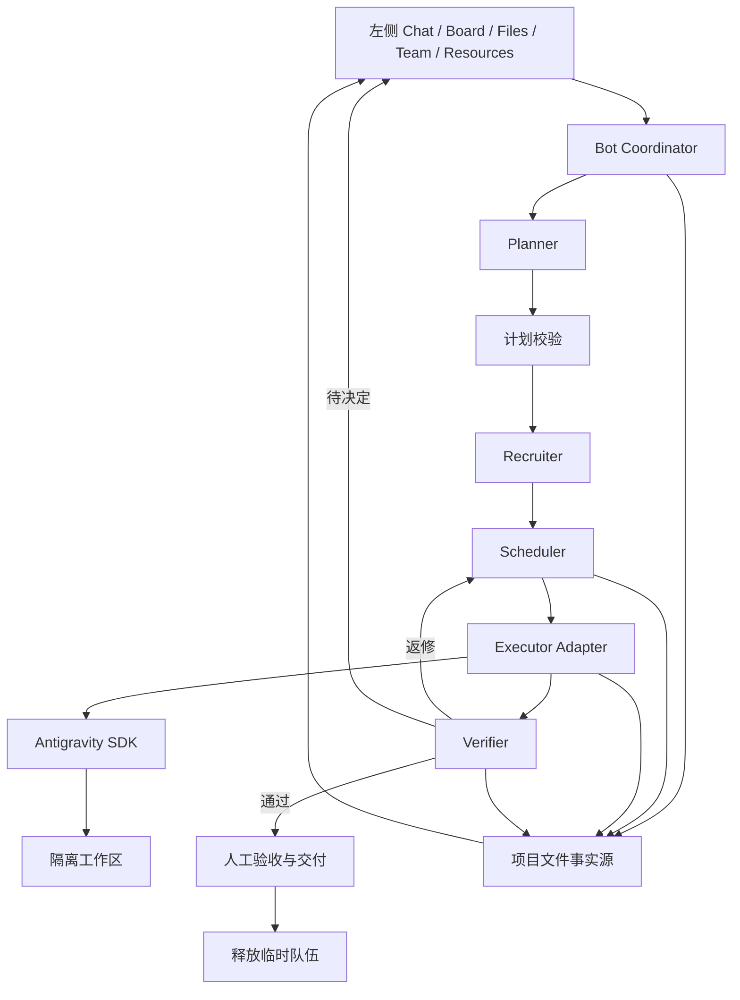

# LightGravity Bot 产品与架构设计

> 日期：2026-10-14。性质：讨论结论与候选实现设计；没有已运行的 LightGravity Bot 系统。

## 1. 产品边界

LightGravity Bot 接收用户目标，创建或继续一项 Task，为其执行尝试创建最小必要 AI 团队，把目标推进为可验收交付物。常驻的是用户入口和协调服务，临时的是执行成员、SDK 会话及工作资源。

首版服务小型开发需求，例如在一个指定仓库中修复问题或实现有限功能。通用能力通过后续任务类型扩展，不在首版承诺任意需求都能自动完成。

对比单 agent 的价值需要实测：在相同任务与资源约束下，观察完成率、耗时、模型成本、人工修正和返工。角色数量与看板效果不能替代交付证据。

## 2. 与 Olav OS 的关系

重设计保留：文件事实源、对话管理项目、任务依赖、按需角色、人类决策点、验证与恢复。

首版暂缓：长期员工身份、组织层级、复杂招聘、企业审批、多个历史运行后端、全功能企业文件平台和云同步。

参考组件包括 Olav OS 的 planner、run-plan-executor、scheduler、run-store，以及 Olav Tasks 的 Markdown 任务与文件浏览思路。现有实现中已经有上游结果传递、结构化 outcome、QA/返修和异常恢复处理，可作为调查入口：

- [运行计划与执行](../../olav-os/experiments/t-37-human-ai-swarm-skeleton/lib/run-plan-executor.ts)
- [任务调度与上游上下文](../../olav-os/experiments/t-37-human-ai-swarm-skeleton/lib/scheduler.ts)
- [持久运行记录](../../olav-os/experiments/t-37-human-ai-swarm-skeleton/lib/run-store.ts)
- [Olav Tasks 产品范围](../../olav-tasks/AGENTS.md)

这些链接描述参考来源，不意味着其全部行为或代码已经移植。特别是旧 scheduler 与 run-plan-executor 的能力范围不同，不能把某个入口的顺序执行假定为整个系统的并发行为。

## 3. 总体架构



后端候选是 Python 协调服务与 Antigravity SDK；网页框架、API 框架、文件锁方案和部署方式待实施前确定。不要仅因参考项目使用 Node/Bun 而引入完整跨语言旧服务。需要复用 Node 组件时，先评估小型接口是否足够。

## 4. 调度器与 executor 分工

| 模块 | 职责 | 不应承担的职责 |
|---|---|---|
| Planner | 分析目标，提出任务图、验收条件和能力需求 | 直接授予权限或把任务标记完成 |
| Recruiter | 从角色目录选择成员，绑定 SDK、工具、上下文与预算 | 创建不必要的长期组织实体 |
| Scheduler | 依赖、领取、并发、超时、暂停、取消与返修调度 | 以自然语言回复代替验收 |
| Executor Adapter | 执行一个任务，规范化事件、结果、取消与关闭 | 控制整个团队生命周期 |
| Verifier | 检查实际产物和运行结果，发起复核 | 只相信 worker 的自评 |
| Run Store | 统一写入持久文件，提供事件和查询视图 | 维护另一套冲突的业务状态 |

模型提出计划和组队建议，程序校验并实施。计划校验至少检查依赖无环、引用任务存在、角色存在、验收条件非空、权限与预算有效，以及并行任务的工作区边界。

## 5. 自动组队

agency-agents 是候选角色内容来源，首版只筛选少量开发角色。为模板增加本项目管理的能力标签、适用范围与版本/哈希记录；模板描述不代表角色具备实际执行能力。

招募过程：分析任务所需能力 → 匹配候选角色 → 选择最小必要集合 → 分配任务 → 绑定工具权限与 SDK → 保存 team 记录。

临时成员记录至少包含：`memberId`、`roleId`、`templateVersion`、`skillRefs`、`sdk`、`sessionId`、`toolPolicy`、`workspace`、`assignedTaskIds`、`budget`、`status`。`skillRefs` 保存获准技能的标识与版本/哈希，不复制密钥。

例如，单个页面修改可以只安排开发者与验证者；涉及接口时再增加后端或接口测试角色。不强制每次任务启动固定全套人员。

指令内容与工具授权分离。模板中写有部署职责，不自动获得部署工具或凭证。同一 SDK 的不同角色会话也不等于不同模型或不同故障模式，QA 仍需真实检查证据。

### 5.1 Role、Skill 与 Tool

| 层次 | 含义 | 示例 |
|---|---|---|
| Role | 成员承担的职责与交付责任 | 开发者、研究者、验证者 |
| Skill | 完成某类工作的步骤、约定与引用资料 | 需求拆分、资料研究、代码审查、测试报告 |
| Tool | 实际执行操作的能力 | 文件读取/修改、命令执行、网页搜索 |

Recruiter 为每个成员绑定角色指令、所需技能、工具权限、工作区与预算。一个角色可以使用多个技能，同一技能可以供多个角色使用。agency-agents 的角色内容可作为指令或转换后的技能输入，具体映射需明确；不能因为都使用 Markdown 就混同职责与能力。

### 5.2 SDK 原生 skills 接入

当前 SDK 配置源码提供 `skills_paths` 和 `inline_skills`。官方示例使用 `LocalAgentConfig(skills_paths=[skill_path])` 加载包含 SKILL.md 的技能目录。首版优先使用该机制，不实现第二套通用技能加载器。[技能示例](https://github.com/google-antigravity/antigravity-sdk-python/blob/main/examples/getting_started/agent_skills.py)、[配置源码](https://github.com/google-antigravity/antigravity-sdk-python/blob/main/google/antigravity/connections/connection.py)

项目级技能候选目录为 `.lightgravity/skills/<skill-id>/SKILL.md`，可附 `references/` 和 `scripts/`。这一目录是本项目约定，需通过 `skills_paths` 显式配置；不假定 SDK 自动扫描它。共享角色和技能模板独立于临时团队保存。

adapter 只向成员暴露本任务获准的技能，保存使用的版本/哈希；引用文件应可访问，脚本依赖需安装，工具仍按权限配置。加载技能并不意味着脚本自动成为已授权工具；有必要时通过命令工具、显式自定义工具或 MCP 绑定。

首批技能建议覆盖任务规划、实现与测试、独立审查、证据汇报；研究技能按实际任务加入。技能发现、按需读取、引用资源访问、跨会话作用域和 agency 转换格式兼容性均列入 SDK 执行探针。核对版本的本地配置不允许 skills_paths 与 inline_skills 同时设置；选择单一 source，由 adapter 校验，见 [SDK 能力审计](03-sdk-capability-audit.md)。

### 5.3 基础工具优先复用 SDK

截至 2026-10-14 核对的源码，SDK 定义了以下内置工具。这表示接口存在，不表示 LightGravity Bot 已启用或已经验证其运行行为。

| 能力 | 内置工具标识 |
|---|---|
| 文件读取 | `view_file` |
| 创建与编辑文件 | `create_file`、`edit_file` |
| 目录列表、内容检索与文件查找 | `list_directory`、`search_directory`、`find_file` |
| 命令执行与检查 | `run_command` |
| 网页搜索 | `search_web` |
| 获取网页内容 | `read_url_content` |

按成员使用 `CapabilitiesConfig.enabled_tools` 等配置选择所需工具，并配置相应策略；写入、命令和 MCP 的策略要求由实际 SDK 版本核实。工具存在不意味着默认开启全部能力。官方 URL 示例还说明较大页面可能缓存到文件，需要文件读取能力检查缓存内容。[工具定义](https://github.com/google-antigravity/antigravity-sdk-python/blob/main/google/antigravity/types.py)、[网页工具示例](https://github.com/google-antigravity/antigravity-sdk-python/blob/main/examples/getting_started/web_tools.py)、[Agent 策略检查](https://github.com/google-antigravity/antigravity-sdk-python/blob/main/google/antigravity/agent.py)

研究成员按任务获得搜索、URL 和资料读取能力；开发成员获得隔离工作区内的文件修改与必要命令；QA 成员读取候选版本并运行获准检查。配置工作区不能自行视为操作系统隔离，仍需验证文件越界与命令执行边界。

worker 通过 SDK 修改工作成果。任务领取、控制状态、验收结论与队伍释放由调度器/Run Store 写入；worker 不得任意编辑运行控制文件。必要时提供受控工具提交结果或请求状态变更，再由程序校验落盘。

首版不另建文件读写、搜索引擎或网页抓取框架。确认内置能力满足真实案例后复用；发现具体缺口时才增加自定义工具或 MCP。网页搜索与 URL 读取不等同于完整浏览器自动化，浏览器操作须另行验证或接入。

## 6. Executor 契约

以下是拟定义的应用接口，不是 Antigravity SDK 原生接口：

```python
class Executor:
    async def execute(self, task, context, emit_event) -> TaskResult: ...
    async def cancel(self, execution_id) -> None: ...
    async def close(self, session_id) -> None: ...
```

任务输入包含 Task／Run／Subtask／尝试编号、目标、验收条件、上游产物引用、工作目录、角色指令、工具范围、截止时间与预算。Executor 的派发单位是 Subtask；Task 可以在后续运行中继续。SDK 接口与上述能力之间的映射须实测；不能假设所有 SDK 都能提供相同的取消、恢复或用量统计。

结果包含执行状态、摘要、产物引用、代码 diff、命令与检查记录、会话 ID、失败原因，以及后端实际可取得的用量。不能取得的字段标为未知，不伪造成本。

worker 成功只表示执行返回，不代表任务验收通过。首版只实现 Antigravity adapter，多 SDK 为后续扩展。

## 7. 调度与验收闭环

1. 保存用户指令和运行标识。
2. 生成并校验计划，保存计划版本。
3. 创建临时成员并保存团队记录。
4. 找到依赖已通过验证的任务，检查额度和工作区冲突。
5. 原子领取任务，记录执行尝试，再调用 executor。
6. 持续保存可取得的事件；完成后保存实际产物和结果。
7. 运行验证，必要时由独立 reviewer 复核。
8. 通过后解锁下游；失败生成有限返修；信息不足进入等待用户。
9. 汇总候选交付、证据与待验收通知；确认 worker 已停止，关闭会话与临时资源，归档队伍并释放执行槽。
10. 等待用户验收，同时处理新消息与其他排队任务；拒绝验收时在同一 Task 创建返修尝试并按需重建团队。

本流程只用于需要交付的工作。普通问答和获准只读工具请求通过有界轻路径处理，不强制规划与组队；消息路由见 [Bot 行为契约](04-bot-behavior.md)。

上游依赖的完成状态必须伴随产物交接。下游获取相关摘要、文件路径与版本/哈希，不接收整个项目历史作为默认上下文。

Task 的用户状态与 Subtask 的执行状态分开。Task 以 `todo/in-progress/done` 表示工作进度，详细阶段、等待与验收字段见 docs/02；只有人工验收后置为 done。Subtask 建议状态：`pending → ready → running → verifying → passed`；分支为 `repairing`、`waiting_user`、`paused`、`failed`、`cancelled`。Run 建议状态：`planning → recruiting → executing → verifying → awaiting_acceptance → completed`；分支为 `waiting_user`、`pausing`、`paused`、`recovery_required`、`failed`、`cancelling`、`cancelled`。团队清理状态单独记录，避免交付成功与清理失败相互掩盖。

这是运行时状态，不直接改写 Olav Tasks 的 `todo/in-progress/done` 契约。若接入既有看板，需显式投影并保留详细执行状态。

验收条件分为机器检查、独立 reviewer 判断与人工最终验收。结构化结果至少说明通过/失败/阻塞、证据、问题及可返修目标。程序核对证据存在，引用的是当前候选版本；无法机械判断语义正确性的事项交给 reviewer 或用户。

## 8. 并发、失败与恢复

首版建议一个占用执行槽的交付 Run、最多三个 worker、两个并行子任务和一轮自动返修。其他 Task 可以排队；确认停止的待用户或待验收 Run 不占执行槽。达到预算、时间或返修上限后暂停或失败，保留原因和已有成果。

代码写任务采用独立 worktree；并行任务完成后生成整合候选版本，QA 检查整合后的版本。共享目录的文件白名单不能替代隔离。文档任务如共享文件，需锁或明确串行执行。

调度器通过任务领取、版本检查、租约/心跳与尝试编号避免重复执行。进程异常后，对已开始但结果不明确的任务先检查产物和副作用；不能简单重置为 ready 后自动重放。

取消先阻止新调度，再请求取消活跃执行并确认其停止，最后释放资源。暂停与取消分开记录。用户等待期间保存 checkpoint，按明确等待期限释放空闲进程，保留恢复所需计划、成员配置与产物。待验收 Run 在 worker 停止后不占执行槽；Task 排队、暂停和恢复规则见 docs/04。

“解散”表示结束临时成员与资源，不删除角色模板、运行证据或成果。未交付的 diff/worktree 在完成保留或导出前不得删除；清理失败留下可重试记录。

## 9. 项目管理与文件事实源

Task 是用户要完成的工作，拥有独立目录、对话和验收条件；Subtask 是内部派发节点；Run 是一次执行尝试；Project 是可选共享背景。Task 可跨多个 Run 持续，补充消息不自动创建新 Run。运行完成后释放团队，保留 Task 和交付物。

候选项目布局：

```text
bot-data/
├── resources/                   # Markdown 资源目录
├── projects/<project-id>/       # 可选共享背景与仓库引用
└── tasks/<task-id>/
    ├── TASK.md                  # frontmatter 当前状态＋目标与验收
    ├── conversation.jsonl      # 用户对话
    ├── inputs/
    ├── artifacts/
    ├── deliverables/
    └── runs/<run-id>/
        ├── RUN.md
        ├── PLAN.md
        ├── team/<member-id>.md
        ├── subtasks/<subtask-id>/SUBTASK.md
        ├── events.jsonl
        ├── sdk/                 # SDK 原生会话数据
        └── summary.md
```

这是未来用户项目的候选布局，本仓库当前只创建设计文件。

| 信息 | 权威文件 | 其他视图 |
|---|---|---|
| 可选长期目标与规则 | PROJECT.md | 必要的任务上下文 |
| Task 当前状态、目标与验收 | TASK.md | Board、任务详情 |
| 用户消息与决定 | conversation.jsonl | Task Chat |
| 当前计划与版本 | PLAN.md | 依赖图 |
| 团队配置与状态 | team/*.md | Team 展示 |
| 运行与子任务当前状态 | RUN.md、SUBTASK.md | 执行详情 |
| 历史事件 | events.jsonl | Activity |
| 实际成果与证据 | 工作文件、artifacts、deliverables | Files、任务链接 |
| 汇总说明 | summary.md | 完成汇报 |

Markdown frontmatter 保存当前结构化状态，正文保存目标、说明与验收条件；JSONL 保存历史消息和事件，summary 不维护另一套状态。所有变更经过 Run Store，采用原子文件替换、版本检查和可恢复的写入流程。多个文件与事件追加并不天然具有事务性，需用写入标识/日志及恢复规则处理部分写入；具体方案待实现选择。详细字段和 SDK 资源映射见 [Task 与 SDK 资源契约](02-task-and-sdk-resources.md)。

数据库可作为索引和查询缓存，可从权威文件重建。进程句柄是临时运行状态。密钥不写入项目文件，使用环境或部署平台的凭证机制。

## 10. 左侧 Chat、Board、Files、Team 与 Resources

Chat 接收问题、目标、补充证据、展示结果和请求必要决定；全局对话保留普通问答与 Task 导航，交付工作进入 Task 对话。Board 的主卡片是 Task，内部展开 Subtask 与 Run；Files 默认打开 Task 目录。任务对话历史按 Task 标题与详细阶段展示。可以直接指定 Task 目录开始对话；Project 可选，不要求先进入 Project。浏览器断开不取消后台执行，通知与重连按 docs/04 管理。

同一 Task 的所有用户对话由 Coordinator 接收，不因打开聊天创建并行写 agent。执行中新增要求先记录，再由协调器判断暂停、修订计划或排队。SDK 成员会话与工具输出作为执行详情展示，不混入用户主对话；目录决定上下文入口，不自动决定 SDK 的完整文件权限。

文件管理首版提供项目范围内的文件树、预览、上传、下载、任务产物定位与版本变化提示。目录越界、符号链接和并发编辑需要明确处理。新建、批量移动、复杂在线编辑、共享盘和版本管理平台均待后续需求决定。

五个一级入口放在固定左侧窄图标栏，顶栏用于范围和面板控制。Agent 合并到 Team 的待招募/已招募，分别读取角色模板与临时成员实例；历史 Run 保留已释放名单。Resources 集中管理 Connections、Session Profiles、Hooks、MCP、Tools、Triggers、Skills，Conversation 实例在 Chat/成员详情中查看。完整布局、范围和交互见 [左侧导航、Team 与 Resources](05-navigation-and-team.md)。

左导航底部另提供 Settings 接入模型和管理凭证，使用同一 Connection 权威文件；默认引用在 SETTINGS.md，敏感值只进后端秘密存储。设置页表单是普通资源对话修改规则的必要例外，不增加第二份配置库。首版先 Gemini，其他 SDK 后端待验证开放，见 [模型设置](07-settings-and-models.md)。

参考 Olav OS 的文件管理器时先追踪组件依赖；独立实现必要交互也是候选方案，不预设整体移植。

## 11. 首版交付顺序

本节给出设计交付顺序；具体开发任务已拆为 LG-001～027，见 [BACKLOG](../BACKLOG.md) 与 [滚动排期](06-roadmap.md)。LG-025～027 补充模型设置、凭证和专项验收。规划已落盘，尚未启动实现。

| 顺序 | 交付 | 验收依据 |
|---|---|---|
| 1 | SDK 执行探针 | 验证获准 skills 发现与资源读取、文件读写、目录检索、网页搜索/URL 读取；在隔离示例仓库真实修改并运行检查，验证流式事件、权限与停止行为 |
| 2 | 单运行文件存储 | 计划、任务、事件可读取，索引可重建，部分写入与重启行为明确 |
| 3 | 最短开发闭环 | 一条指令、开发者与验证者、真实修改、QA、人工验收、释放会话 |
| 4 | 按需组队与依赖调度 | 不同需求选择必要角色，依赖解锁同时传递产物，额度有效 |
| 5 | 左侧工作入口、Settings 与常驻服务 | 消息分流、任务队列、范围一致；模型接入与 Connections 共用配置；Team 实例固定版本；查询、重连与通知有效 |
| 6 | 有限返修与恢复 | 可复现失败进入返修，超限停止，取消/重启不静默重放 |
| 7 | 对照评估与部署准备 | 固定任务集与单 agent 对照，记录完成率、成本和人工修正；部署另行验收 |

Google Cloud 是参赛部署候选，网页/API 与持久 worker 如何部署待验证。不能把请求生命周期有限的服务当作已经满足长期任务、会话与本地文件持久化要求。

## 12. 外部组件与未决事项

截至本轮查阅，Antigravity SDK 仓库说明提供 agent loop、会话、流式输出、自定义工具、MCP 和策略，并依赖 PyPI 平台 wheel 中的编译 runtime；仅 clone 不足以运行。采用前验证具体版本、操作系统、认证、取消与云环境兼容性。[SDK 文档](https://github.com/google-antigravity/antigravity-sdk-python)

agency-agents 有角色模板与 Antigravity 转换方式，但 SDK 是否直接发现转换目录、如何注入角色内容和工具能力，仍需实测。首版可以通过 adapter 显式加载经过筛选的角色内容。[角色仓库](https://github.com/msitarzewski/agency-agents)

SDK 仓库标示 Apache-2.0，角色仓库提供 MIT LICENSE；复用时按实际文件保留所需版权与许可说明，不以 README 的简写替代许可证。[SDK LICENSE](https://github.com/google-antigravity/antigravity-sdk-python/blob/main/LICENSE)、[角色 LICENSE](https://github.com/msitarzewski/agency-agents/blob/main/LICENSE)

首版按单用户本地网页与常驻服务设计，云端访问另行验证。实施前需确定：首个真实任务类型、角色子集、技术栈、SDK 固定版本、预算与认证、状态写入恢复策略、worktree 整合策略、消息传输与进程管理方式。Bot 层行为与端到端验收见 docs/04。

本设计不证明参赛合格。比赛要求 Google AI/指定平台与 Cloud Run/Firebase 部署，并排除已有项目；已有私有项目和公开依赖的复用范围不能自行假定为例外。先如实说明拟复用资产并向主办方确认，产品研发可按自身目标独立推进。[主题与要求](https://aibuildercup.com/themes.html)、[资格与提交 FAQ](https://aibuildercup.com/Faqs.html)
